<div align="center">


# Pylox Panel

**A modern, self-hosted game server management panel.**

Create, deploy and manage Docker-based game servers (Minecraft, and anything you can write an egg for) from a single, fast web panel — powered by a lightweight per-node daemon called **Rubityle**.

[](https://nodejs.org)
[](https://expressjs.com)
[](#license)
[](#)
[](#)

</div>

---

## Table of contents

- [Overview](#overview)
- [Screenshots](#screenshots)
- [Features](#features)
- [Architecture](#architecture)
- [Tech stack](#tech-stack)
- [Requirements](#requirements)
- [Installation](#installation)
  - [1. Panel](#1-panel)
  - [2. Daemon (per node)](#2-daemon-per-node)
- [Configuration](#configuration)
- [Usage](#usage)
- [Client API](#client-api)
- [Extensions](#extensions)
- [Project structure](#project-structure)
- [Internationalization](#internationalization)
- [Security](#security)
- [Roadmap](#roadmap)
- [License](#license)

---

## Overview

Pylox Panel is a from-scratch reimplementation of the Pterodactyl control-plane idea in plain Node.js. It is split into two cooperating applications:

| Component | Package | Role |
| --- | --- | --- |
| **Panel** | `pylox-panel` (`server.js`) | Web UI, authentication, database, admin area, client API. Holds *no* Docker access. |
| **Daemon** | `rubityle` (`daemon/daemon.js`) | Runs on each node, owns Docker, creates/limits game containers, serves the live console over WebSocket and SFTP on port `2022`. |

The panel never talks to Docker directly — it proxies every server action and the game console to the node's daemon over a token-authenticated HTTP/WebSocket API. This keeps the panel safe to expose outside a single machine while Docker stays where the resources actually are.

---

## Screenshots

### Sign in

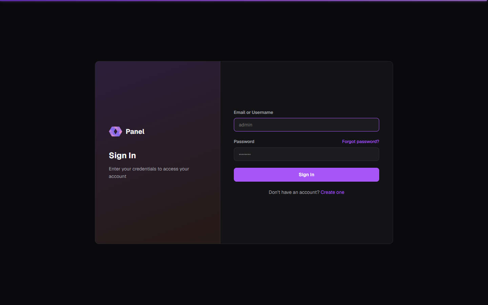

### Server dashboard

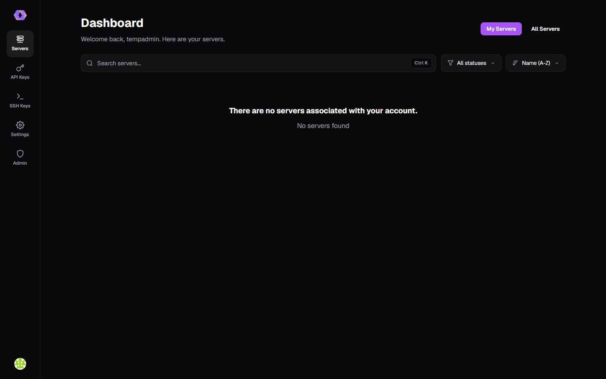

### Admin area

| Admin overview | Nodes |
| --- | --- |
| 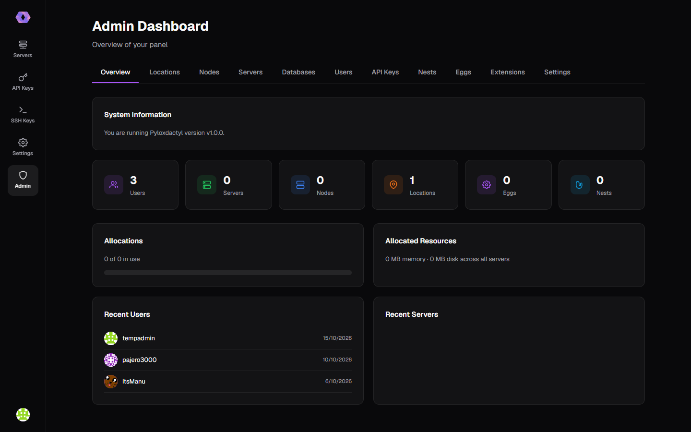 | 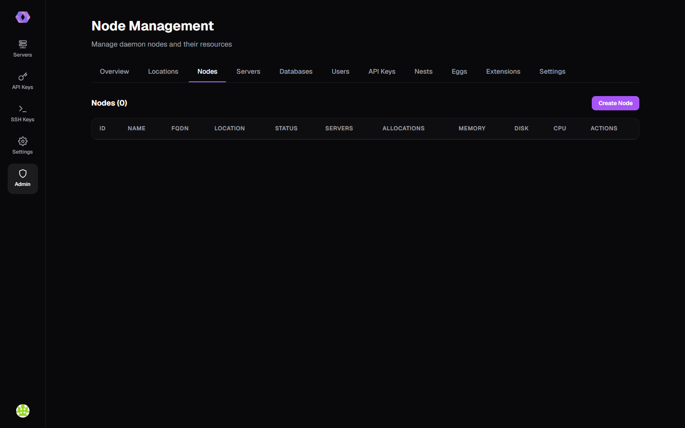 |

| Servers | Users |
| --- | --- |
| 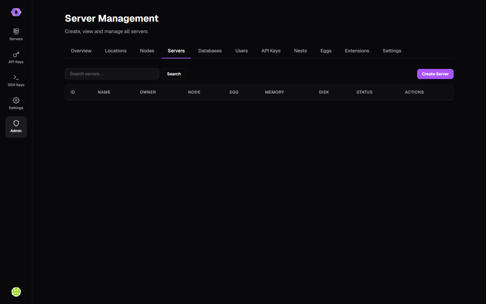 | 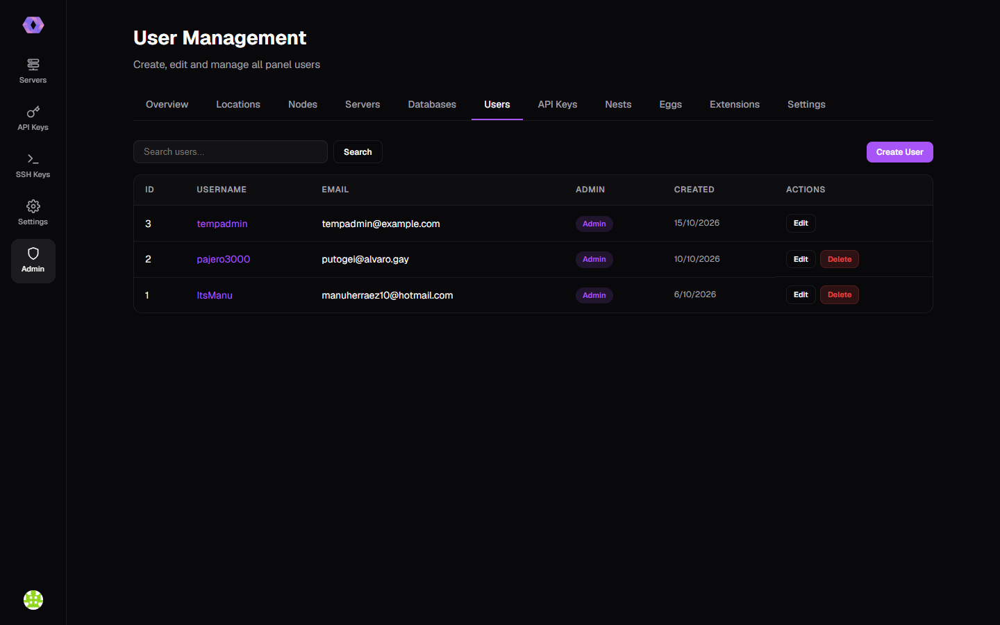 |

| Nests | Eggs |
| --- | --- |
| 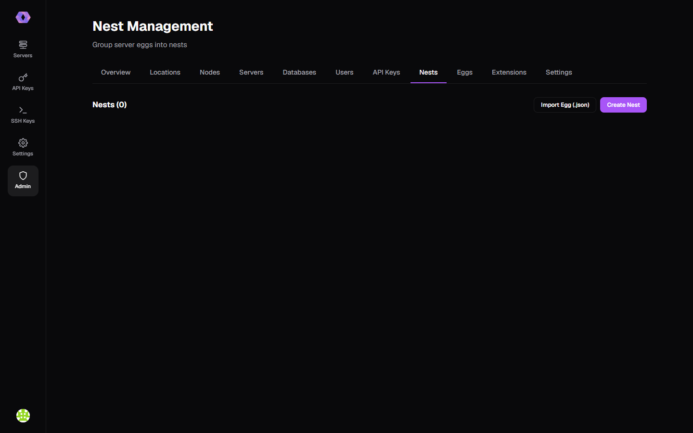 | 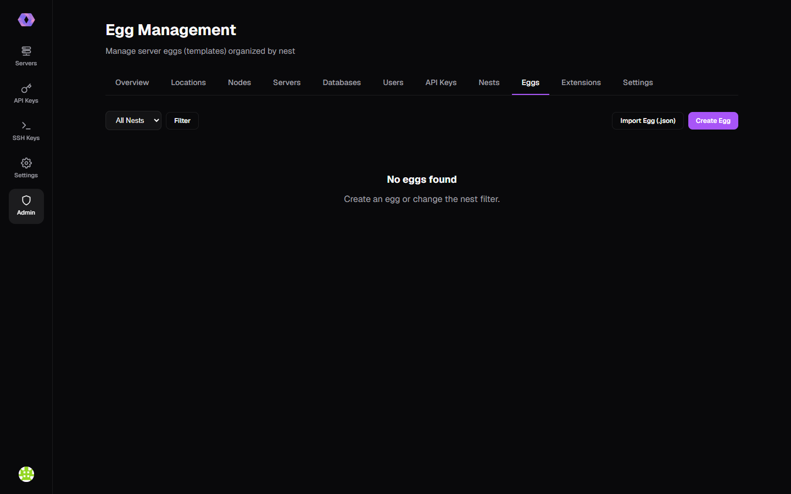 |

| Extensions | Settings |
| --- | --- |
| 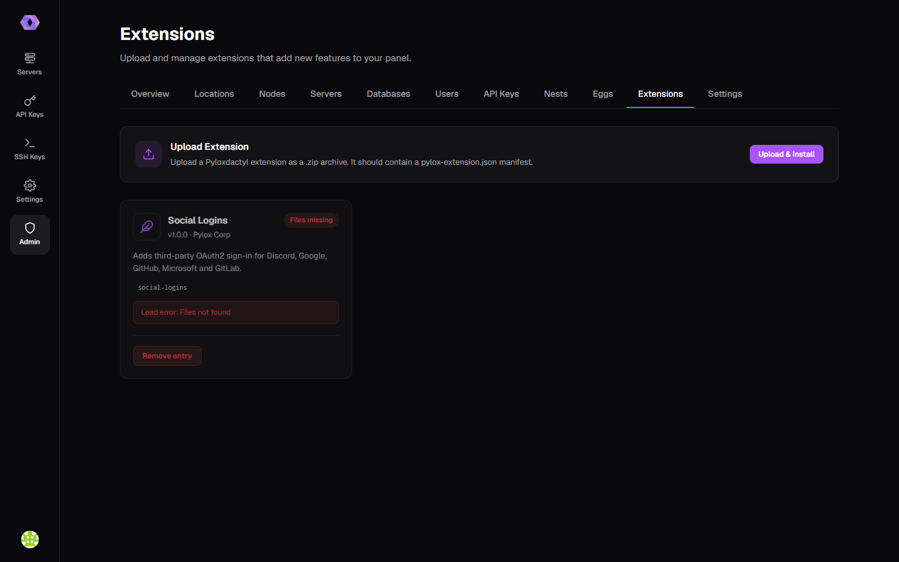 | 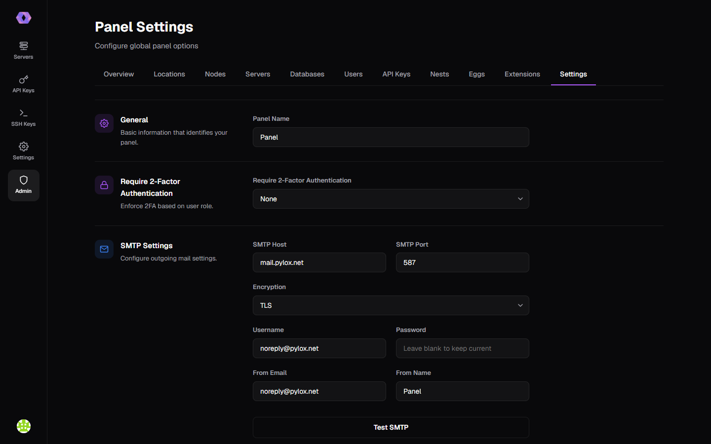 |

### Account settings

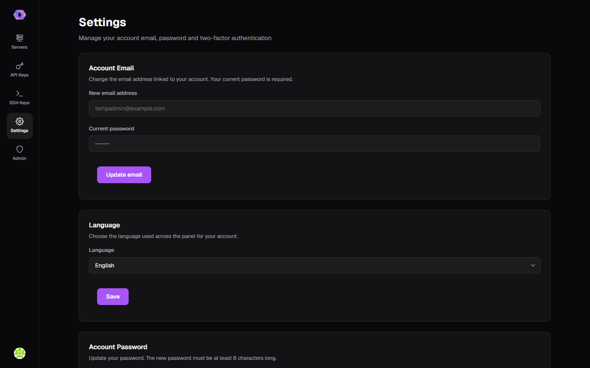

---

## Features

### Server management
- **Power controls** — start, stop, restart, kill, live status.
- **Crash recovery** — reports the exit code and OOM status to the console and restarts the server; a second crash within 60 seconds aborts the automatic restart.
- **Live console** over WebSocket, with command input and status messages, proxied through the daemon.
- **File manager** — browse, upload, edit (built-in code editor with Prism highlighting), create, rename, move, chmod, compress/extract archives, duplicate and download files.
- **Databases** — create and delete per-server MySQL databases.
- **Backups** — create, download, delete, lock and restore.
- **Schedules** — automate power actions and commands on a cron-like schedule.
- **Startup variables** — edit egg-defined variables and the startup command.
- **Settings** — rename, regenerate SFTP password, reinstall, toggle EULA.
- **Subusers** — grant other panel accounts fine-grained access to a single server.

### Administration
- **Nodes** — register daemons (FQDN, token, port), track allocations and health.
- **Locations & allocations** — organise where servers live and the IP:port pool they use.
- **Nests & eggs** — define server templates, variables and startup configs; import eggs from JSON.
- **Servers** — create/edit build limits, startup, network and databases; transfer and reinstall.
- **Users** — full account management.
- **Settings** — site name, timezone, default language, 2FA policy, SMTP, CAPTCHA (Cloudflare Turnstile, hCaptcha, reCAPTCHA) and custom branding (logo/favicon).
- **API keys** — issue and revoke keys for admin and client API access.
- **Extensions** — upload, enable/disable, edit and delete extensions straight from the panel.

### Platform
- **Two-factor authentication** (TOTP) with QR setup, plus optional panel-wide enforcement.
- **Multi-language UI** — English, German, French, Spanish, Dutch, Portuguese.
- **Dual database backend** — SQLite (default, zero-config) or MySQL.
- **Email** — SMTP-driven password resets and notifications.
- **SSH keys** and per-user **API keys**.
- **Rate-limited auth**, Helmet security headers, hashed passwords and per-route permission checks.

---

## Architecture

```
                          ┌────────────────────────────┐
        Browser  ───────► │        Pylox Panel          │
        (HTTPS/WS)        │  Express + EJS + sessions   │
                          │  SQLite / MySQL  •  API      │
                          └──────────────┬──────────────┘
                                         │ token-authenticated
                                         │ HTTP + WebSocket + SFTP
                          ┌──────────────▼──────────────┐
                          │   Rubityle daemon (per node) │
                          │  owns Docker • console • SFTP│
                          └──────────────┬──────────────┘
                                         │ dockerode
                          ┌──────────────▼──────────────┐
                          │  pylox-<uuid> game container │
                          │   (network: pylox-servers)   │
                          └─────────────────────────────┘
```

- The panel keeps resource limits and status in the database as the **source of truth** and re-syncs RAM/CPU/disk limits with every node's daemon on a 60s loop.
- Game containers are prefixed `pylox-` and attached to the `pylox-servers` Docker network.
- The daemon enforces RAM/CPU/disk limits and monitors running servers every `RESOURCE_MONITOR_INTERVAL_SECONDS`.

---

## Tech stack

**Panel** — Node.js (CommonJS), Express 4, EJS, `express-session`, `helmet`, `morgan`, `express-rate-limit`, `bcryptjs`, `nodemailer`, `ws`, `sql.js` (SQLite) / `mysql2`, `multer`, `archiver`, `unzipper`, `qrcode`, `uuid`.

**Daemon (Rubityle)** — Node.js, Express, `dockerode`, `ssh2` (SFTP), `ws`, `archiver`.

**Frontend** — server-rendered EJS, hand-written CSS (`public/css/style.css`), vanilla JS, vendored Prism + CodeJar, Geist font.

**Tooling** — two Python stdlib scripts help maintain locale files.

---

## Requirements

- **Node.js 18+** (20 recommended; the daemon Docker image uses `node:20-alpine`).
- **Docker** on every node that will run game servers.
- Optional: **MySQL 8+** if you prefer it over the default SQLite.

---

## Installation

### 1. Panel

```bash
git clone <your-repo-url> pyloxdactyl
cd pyloxdactyl
npm run setup        # npm install + create/migrate the database
cp .env.example .env # or copy the sample in "Configuration" below
npm start            # http://localhost:7956 (or APP_PORT)
```

Open the panel in your browser. On a freshly created database you'll get an animated welcome screen followed by a short setup form that creates the **root administrator**; the regular register page is used for everyone else after that.

> No build/bundling step is required; the panel runs directly from source.

### 2. Daemon (per node)

On each machine that will host game servers (Linux recommended):

**Option A — installer script**

```bash
sudo bash daemon/install.sh
```

This installs Docker, Docker Compose and Node if missing, copies the daemon to `/opt/rubityle`, generates a `DAEMON_TOKEN`, creates a `rubityle` systemd service, and installs a `rubityle` CLI (`rubityle start|stop|restart|status|logs`).

**Option B — Docker Compose**

```bash
cd daemon
cp .env.example .env   # set DAEMON_TOKEN and PANEL_URL
docker compose up -d --build
```

**Option C — run from source (dev)**

```bash
cd daemon
npm install
npm start              # listens on DAEMON_PORT (default 8080)
```

Then, in the panel: **Admin → Nodes → Create Node**, enter the daemon's address (`your-server-ip:8080`) and the `DAEMON_TOKEN`. Add allocations and create your first server.

---

## Configuration

### Panel — `.env`

```ini
# Pylox Panel Configuration
NODE_ENV=production
APP_PORT=7956
APP_URL=http://localhost:7956
APP_KEY=change-me-to-a-random-32-char-string!!

# Database: "sqlite" (default) or "mysql"
DB_DRIVER=sqlite

# SQLite (used when DB_DRIVER=sqlite)
DB_PATH=./data/panel.db

# MySQL (used when DB_DRIVER=mysql)
DB_HOST=127.0.0.1
DB_PORT=3306
DB_USER=pylox
DB_PASSWORD=change-me
DB_NAME=pylox
DB_CONNECT_TIMEOUT=10000
DB_QUERY_TIMEOUT=30000

# Session
SESSION_SECRET=change-me-to-another-random-string

# Daemon
DAEMON_SECRET=change-me-daemon-secret-key
DAEMON_URL=http://localhost:8080

# Docker
DOCKER_SOCKET=/var/run/docker.sock
DOCKER_NETWORK=pylox-servers

# File upload limit (MB)
MAX_UPLOAD_SIZE=100
```

### Daemon — `daemon/.env`

```ini
# Rubityle Configuration
DAEMON_PORT=8080
DAEMON_TOKEN=change-me-daemon-token
PANEL_URL=http://your-panel-url:7956
PANEL_API_KEY=
DOCKER_SOCKET=/var/run/docker.sock
DOCKER_NETWORK=pylox-servers
DATA_DIR=/var/lib/rubityle
LOG_DIR=/var/log/rubityle
SFTP_PORT=2022
# Owner applied to server files after root-run install containers finish.
SERVER_UID=1001
SERVER_GID=1001

# A server sitting at/above a RAM/CPU/DISK limit for this many seconds is killed.
RESOURCE_LIMIT_GRACE_SECONDS=600
# How often (seconds) running servers are checked against their limits.
RESOURCE_MONITOR_INTERVAL_SECONDS=15
# A crashed server is restarted unless it crashed again within this many seconds.
CRASH_RESTART_COOLDOWN_SECONDS=60
```

> **Note:** Site name, timezone, language, 2FA policy, SMTP, CAPTCHA and branding are stored in the database and edited at **Admin → Settings** — no environment variables needed. Per-node daemon URLs and tokens live in the `nodes` table (Admin → Nodes).

### npm scripts

| Command | Description |
| --- | --- |
| `npm start` / `npm run dev` | Start the panel (`node server.js`). |
| `npm run daemon` | Start a local daemon (`node daemon/daemon.js`). |
| `npm run migrate` | Create/migrate the database only (`node lib/db.js`). |
| `npm run setup` | `npm install && node lib/db.js`. |

> Lost root access? Stop the panel, then run `node scripts/promote-admin.js <email>` (append `0` to demote). The panel keeps the database in memory and rewrites it every 5 seconds, so it must be stopped first.

---

## Usage

1. **Start the panel** — `npm start`. Root `/` redirects to `/dashboard` (when signed in) or `/auth/login`.
2. **Register the first account** — it becomes the root admin.
3. **Add a node** — Admin → Nodes, pointing at a running Rubityle daemon.
4. **Create a location & allocations** — Admin → Locations, then add IP:port allocations to the node.
5. **Create a nest/egg** — use or import an egg that describes your game (image, startup command, variables).
6. **Create a server** — Admin → Servers, assign the node, allocation, egg and resource limits.
7. **Manage it** — open the server from the dashboard for console, files, databases, backups, schedules and settings.

Live console WebSocket endpoint: `ws://<panel>/ws/console?server=<uuid>`.

---

## Client API

Authenticate with a client API key (create one at **Account → API Keys**) using a Bearer token:

```bash
curl -H "Authorization: Bearer <api-key>" http://localhost:7956/api/client
```

| Method | Endpoint | Description |
| --- | --- | --- |
| `GET` | `/api/client` | List the account's servers. |
| `GET` | `/api/client/server/:uuid` | Get a single server. |
| `POST` | `/api/client/server/:uuid/power` | Send a power signal (`start`/`stop`/`restart`/`kill`). |
| `GET` | `/api/client/server/:uuid/variables` | List startup variables. |
| `GET` | `/api/client/server/:uuid/databases` | List databases. |
| `GET` | `/api/client/server/:uuid/backups` | List backups. |

---

## Extensions

Pylox supports installable extensions — each is a `.zip` containing a `pylox-extension.json` manifest and an entry file. Extensions can register routes, inject markup into view hooks, add auth providers (e.g. OAuth) and add admin tabs. Install and manage them at **Admin → Extensions**.

For the full manifest format and API, open [`EXTENSIONS_DEVELOPMENT_GUIDE.html`](EXTENSIONS_DEVELOPMENT_GUIDE.html) in your browser.

---

## Project structure

```
.
├── server.js                 # Panel entry point (Express + WebSocket proxy)
├── routes/                   # auth, dashboard, server, admin, api, account
├── middleware/auth.js        # auth, admin, per-server & API-key guards
├── lib/                      # db, daemon client, extensions, i18n, mailer, permissions, totp, ...
├── views/                    # EJS templates (auth, dashboard, server, admin, account, errors)
├── public/                   # css, js (vendored Prism/CodeJar), fonts, img, uploads
├── locales/                  # en, de, fr, es, nl, pt
├── extensions/               # distributable extension .zip
├── data/                     # runtime: panel.db, extensions/, backups/, uploads/  (gitignored)
├── daemon/                   # Rubityle daemon (own package.json)
│   ├── daemon.js             # Docker lifecycle, console WS, SFTP, resource limits
│   ├── sftp-server.js
│   ├── install.sh
│   └── Dockerfile / docker-compose.yml
├── EXTENSIONS_DEVELOPMENT_GUIDE.html
└── scripts/                   # install.sh, promote-admin.js (admin recovery)
```

---

## Internationalization

The UI ships in **English, German, French, Spanish, Dutch and Portuguese**, with English fallback. Language can be set panel-wide (Admin → Settings) or per user (Account → Settings). Translation files live in `locales/*.json` and are edited directly.

---

## Security

- Passwords hashed with **bcrypt**.
- **TOTP 2FA**, optionally enforced panel-wide.
- **Helmet** security headers and **rate-limited** `/auth` endpoints.
- Session cookies (`httpOnly`, 7-day lifetime).
- Daemon endpoints authenticated with a per-node **`x-daemon-token`**.
- Per-route **permission checks** for server subusers.

> Always change `APP_KEY`, `SESSION_SECRET` and `DAEMON_TOKEN` before exposing the panel, and run it behind HTTPS in production.

---

## Roadmap

- CSRF protection wiring (`csrf-csrf` is already a dependency).
- Automated test suite.
- Persistent session store.

---

## License

**Proprietary — © Pylox Corp.** All rights reserved. No license is currently granted; contact the maintainers for redistribution or commercial use.

<div align="center"><sub>Built by Pylox Corp · Pyloxdactyl (codename <em>Sunset Sky</em>)</sub></div>
